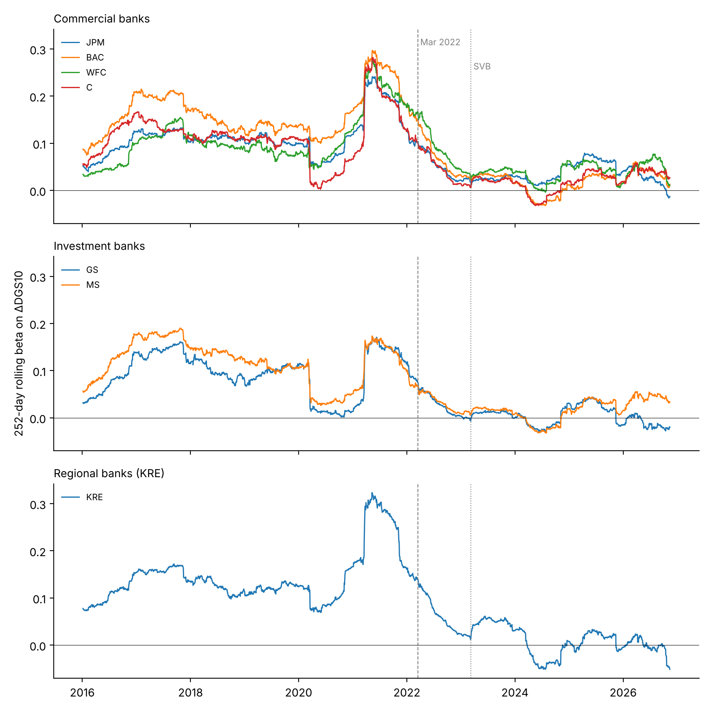

# When Rising Rates Stopped Helping Banks

Replication code for

> Huseynli, Gulara (2026). *When Rising Rates Stopped Helping Banks: Time-Varying Treasury
> Sensitivity of U.S. Bank Stocks, 2015-2026.* SSRN Working Paper. [https://papers.ssrn.com/abstract=7709999](https://papers.ssrn.com/abstract=7709999)

The code downloads the data and reproduces every table and figure in the paper.

## The paper in brief

I study how daily returns of the six largest US bank holding companies (JPM, BAC, WFC, C,
GS, MS) and the regional bank ETF (KRE) co-move with changes in the 10-year Treasury yield,
January 2015 to November 2026 (2,961 trading days).

- **All seven bank betas are positive and significant** (0.035 for GS to 0.078 for BAC),
  while the S&P 500's yield beta is not different from zero (0.005, p = 0.29).
- **Commercial banks are more sensitive than investment banks** by about 0.023
  (Wald = 30.48, p < 0.001), under three different groupings of the banks.
- **Sensitivity collapsed after the first rate increase on 16 March 2022.** Post-break betas
  are 68-97% lower than pre-break betas and stay low through the 2024 easing cycle.
  A change in the market's own yield beta explains only about 25-39% of the decline.



*Figure 1. 252-day rolling beta on the change in the 10-year yield (Model 1). Dashed line:
16 March 2022, first rate increase. Dotted line: 10 March 2023, failure of Silicon Valley Bank.*

## How to reproduce

Requires Python 3.10 or later.

```bash
git clone https://github.com/HuseynliGulara/bank-treasury-sensitivity.git
cd bank-treasury-sensitivity
pip install -r requirements.txt

python run_all.py              # reproduce all tables and figures (about 10 seconds)
pytest -q                      # check the results against the numbers in the paper
```

`run_all.py` writes every table to `results/tables/` and every figure to `results/figures/`.

To rebuild the sample from freshly downloaded data:

```bash
python run_all.py --download   # Yahoo Finance (yfinance) and FRED
```

Yahoo Finance revises adjusted prices when new dividends are paid, so a fresh download can
differ slightly from the data used in the paper. The exact estimation sample used in the
paper is in `data/processed/sample.csv`, and `run_all.py` uses it when the raw price files
are not present.

## Repository structure

```
├── run_all.py               # runs the whole analysis
├── src/
│   ├── config.py            # sample dates, tickers, break date, HAC lags
│   ├── data.py              # download data and build the estimation sample
│   ├── econometrics.py      # HAC OLS, joint cross-equation Wald tests, break tests, rolling betas
│   ├── tables.py            # one function per table in the paper
│   ├── figures.py           # Figures 1, 2 and A1
│   └── text_numbers.py      # numbers quoted in the text
├── data/
│   ├── raw/                 # FRED series (Yahoo price files are downloaded, see data/README.md)
│   └── processed/sample.csv # estimation sample: log returns and first differences
├── results/
│   ├── tables/              # CSV output, named after the paper's tables
│   └── figures/             # PNG and PDF
└── tests/
    └── test_replication.py  # compares output with the published numbers
```

## Where each result comes from

| Paper | Output file | Function |
|---|---|---|
| Table 1. Summary statistics | `table01_summary_statistics.csv` | `tables.table1_summary` |
| Table 2. ADF tests | `table02_adf_tests.csv` | `tables.table2_adf` |
| Table 3. Sensitivity to the 10-year yield | `table03_betas_model1_model2.csv` | `tables.table3_betas` |
| Table 4. Joint HAC Wald tests | `table04_wald_tests.csv` | `tables.table4_wald` |
| Table 5. Structural break, 16 March 2022 | `table05_structural_break.csv` | `tables.table5_break` |
| Table 6. Betas by subperiod | `table06_subperiods.csv` | `tables.table6_subperiods` |
| Table 7. Market-wide vs bank-specific change | `table07a_*`, `table07b_*`, `table07c_*` | `tables.table7_market_vs_bank` |
| Table 8. Alternative maturities and samples | `table08_alternative_maturities.csv` | `tables.table8_robustness` |
| Table 9. Break excluding March-April 2020 | `table09_break_ex_covid.csv` | `tables.table9_break_ex_covid` |
| Table 10. Level and slope | `table10_level_slope.csv` | `tables.table10_level_slope` |
| Table 11. Alternative bank groupings | `table11_bank_groupings.csv` | `tables.table11_groupings` |
| Section 6: HAC lags, 2-year Wald tests, rolling peaks | `text_*.csv` | `tables.hac_lag_sensitivity`, `wald_2y`, `rolling_peaks` |
| Other numbers in the text | `text_numbers.csv` | `text_numbers.text_numbers` |
| Figure 1 | `figure1_rolling_beta_model1.png` | `figures.figure1` |
| Figure 2 | `figure2_rolling_beta_model2_with_market.png` | `figures.figure2` |
| Figure A1 | `figureA1_rolling_beta_ex_covid.png` | `figures.figureA1` |

## Methods

- **Model 1:** r<sub>i,t</sub> = α + β Δy10<sub>t</sub> + γ ΔVIX<sub>t</sub> + δ r<sub>M,t</sub> + ε (two-index model, Stone 1974).
- **Model 2:** the same without the market return, so banks and the market are compared on equal terms.
- **Standard errors:** Newey-West (HAC), 5 lags.
- **Cross-equation tests:** each equation by OLS; the joint covariance of all coefficients comes
  from stacked moment conditions with a Bartlett kernel (5 lags), so the tests are robust to
  heteroskedasticity, serial correlation and correlation across banks.
- **Time variation:** 252-day rolling regressions, a Chow test and a HAC-robust break test at
  16 March 2022, subperiod regressions, and a Model 2 bank-minus-market gap test.

## Data

| Series | Source | Code |
|---|---|---|
| Bank stocks and KRE, adjusted close | Yahoo Finance | JPM, BAC, WFC, C, GS, MS, KRE |
| S&P 500 Total Return index | Yahoo Finance | ^SP500TR |
| S&P 500 price index (dividend check only) | Yahoo Finance | ^GSPC |
| 10-year, 2-year, 3-month Treasury yields | FRED | DGS10, DGS2, DGS3MO |
| CBOE Volatility Index | FRED | VIXCLS |

Data were downloaded on 13 November 2026. See [`data/README.md`](data/README.md).

## Citation

If you use this code, please cite the paper (see [`CITATION.cff`](CITATION.cff)).

## License

Code: MIT License (see [`LICENSE`](LICENSE)). The data belong to their providers and are
subject to their terms of use.

## Contact

Gulara Huseynli, Independent Researcher
